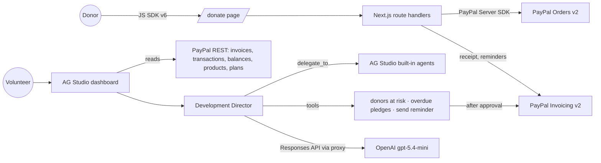

# Gratia — the AI development director for small nonprofits

**Four out of five first-time donors never give again.** Small nonprofits collect through PayPal, but nobody on a team of
volunteers has time to watch who is drifting away, thank people properly or chase the business pledges that never
arrived. Gratia turns a nonprofit's PayPal account into a live dashboard and an AI teammate that does that work, and
never sends anything without a human click.

Built for the [PayPal AI Hackathon 2026](https://paypalaihackathon.devpost.com/) on the PayPal sandbox, for a fictional
shelter, **Harbor Lane Animal Rescue**.

| | |
|---|---|
| Live demo | _added at submission_ |
| Demo video | _added at submission_ |
| Donation page | `/donate` on the live demo |
| Sandbox buyer login | in the Devpost testing instructions |

## TL;DR for judges

- **Dashboard:** every gift, monthly sponsorship and business pledge from PayPal in one [AG Studio](https://www.ag-grid.com/studio/) dashboard, re-themed as Gratia, with our own **donor wall** widget.
- **Agent:** open the dashboard, click **Edit**, then **AI Assistant**, and pick a suggestion. The **Development Director** finds donors at risk, drafts personal notes, sends pledge reminders through **PayPal Invoicing** after you approve them, and delegates dashboard building to **AG Studio's five built-in agents**.
- **Donations:** `/donate` takes a real (sandbox) PayPal payment with the **JavaScript SDK v6**. The order is created and captured with the **PayPal Server SDK**, and a paid receipt lands in PayPal Invoicing, so the gift is on the dashboard at once.
- **Human in the loop:** the model drafts and asks; only a person can press "Send through PayPal". The server re-checks the pledge and rate-limits reminders.

## How we use PayPal

| Capability | API | Where |
|---|---|---|
| Donations | Orders v2: create and capture, through the APIMatic-generated **PayPal Server SDK** (`@paypal/paypal-server-sdk`) | `lib/donations.ts`, `app/api/donations` |
| Checkout button | **PayPal JavaScript SDK v6** (`paypal-payments` donate button) | `app/donate/donate-form.tsx` |
| Gifts, pledges, receipts | Invoicing v2: create, send, record payment, record refund, **remind** | `lib/donations.ts`, `app/api/pledges`, `scripts/seed-demo-data.mjs` |
| Ledger | Transaction Search (three 31-day windows) and Balances | `lib/paypal.ts`, `lib/dashboard-data.ts` |
| Programs and giving plans | Catalog Products and Billing Plans | `lib/paypal.ts` |
| Demo data | All of the above, plus sandbox card captures and a refund | `scripts/seed-demo-data.mjs` |

## How we use AI

- **Model:** OpenAI `gpt-5.4-mini`, called from the browser through a server proxy (`app/api/ai/responses`) that holds the key, allows only configured models and caps output tokens.
- **Agent framework:** AG Studio's Studio Agent Framework. Our **Development Director** (`app/dashboard/studio/ai.ts`) is the primary agent. It talks to AG Studio's built-in **lead** agent through `delegate_to`, and the lead coordinates the planning, data, page and widget agents to build what it asks for.
- **Our tools** (`app/dashboard/studio/donor-tools.ts`):
  - `find_donors_at_risk`: lapsed monthly sponsors, quiet repeat donors and first gifts never followed up, from the PayPal giving history (`lib/insights.ts`).
  - `list_overdue_pledges`: open business pledges past their due date.
  - `send_pledge_reminder`: opens an approval dialog with the exact message; only after a click does PayPal email the reminder.
- **Studio tools** the director also uses: `view_report`, `view_schema`, `execute_query`.
- **Built with AI:** the code was written with Claude Code, using APIMatic's PayPal Context Plugin skills for the PayPal Server SDK and AG Studio's own type definitions. Every change was verified in the browser and covered by tests where it holds logic.

## What makes this different

- **It acts, not just reports.** Reminders go out through PayPal Invoicing, and gifts are captured through Checkout, with a human approving every outbound message.
- **A custom agent that works with AG Studio's own team** of agents, instead of a single chatbot over a chart.
- **A widget AG Studio doesn't ship:** the donor wall leaderboard, which the agents can place too.
- **Instant feedback loop:** each online gift is mirrored as a PayPal invoice receipt, so it appears on the dashboard without waiting hours for Transaction Search.

## Architecture



## Run it locally

You need Node.js 20.9 or later, a [PayPal developer](https://developer.paypal.com) sandbox app (with **Invoicing** and **Transaction search** enabled, linked to a US sandbox business account) and an OpenAI API key.

1. `npm install`
2. Copy `env.example` to `.env.local` and fill in `PAYPAL_CLIENT_ID`, `PAYPAL_SECRET`, `AG_STUDIO_OPENAI_API_KEY` and, optionally, an AG Studio licence in `AG_STUDIO`.
3. `npm run seed` (fills the sandbox with Harbor Lane's year of giving), then `npm run dev` and open http://localhost:3000.

Card donations created by the seed take up to three hours to show in PayPal Transaction Search; invoices and receipts show at once.

## Checks

```bash
npm run lint
npm run typecheck
npm test
```

CI (`.github/workflows/ci.yml`) runs all three on every push.

## What it doesn't do (yet)

- It runs on the PayPal **sandbox** only; no real money or donor data.
- It doesn't send email itself: reminders go through PayPal Invoicing, and thank-you notes are drafted for a person to send.
- Reports are saved in the browser, not shared between team members.
- One organization per deployment.

## Credits

Started from PayPal's official [AG Grid hackathon boilerplate](https://github.com/paypaldev/hackathon-paypal-ag-grid-boilerplate) (its history is kept; our work starts after commit `5de114e`): the PayPal REST client, the AG Studio setup and the OpenAI adapter come from there. Everything else (the seed, donations, the agent and its tools, the approval flow, the donor wall, the Gratia theme and the tests) was built during the hackathon.

## License

[MIT](LICENSE)
